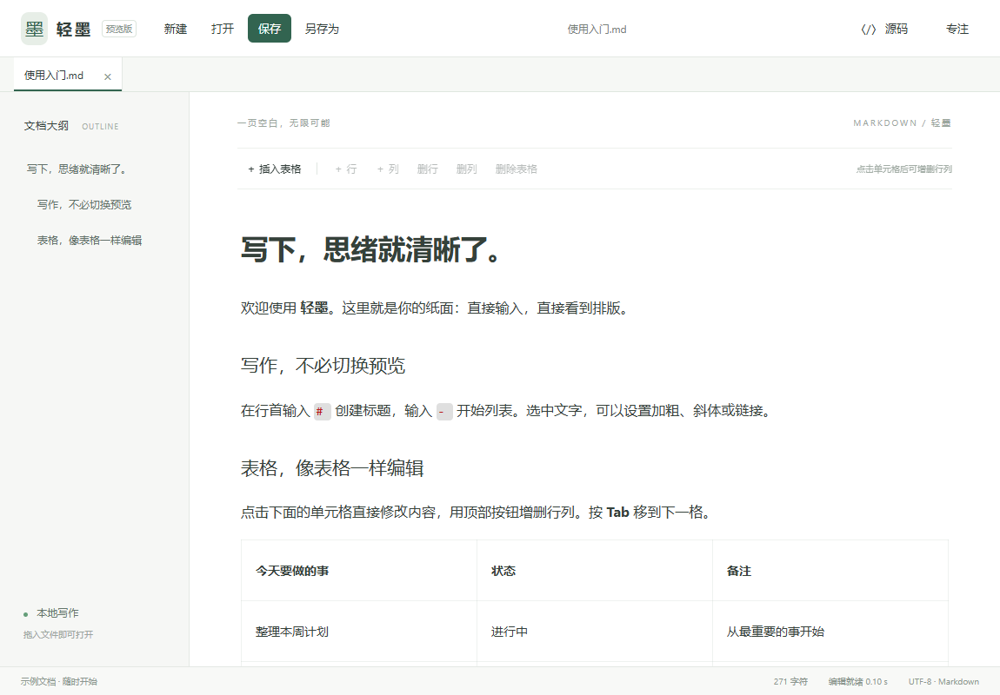

# 轻墨 0.4.3 · Windows Markdown 编辑器

## 运行与更新

这个仓库提供源码。按下方「开发」步骤安装依赖后，执行 `npm run package`，生成的程序位于 `src-tauri/target/release/qingmo.exe`。需要 Windows 10/11 和 Microsoft Edge WebView2 Runtime；界面资源随程序打包，无需联网加载，不注册文件关联。更新已安装的旧版前，请先保存文档并退出。



0.4.3 修正有序、无序列表的序号与正文错位：列表项首段与标记对齐，普通段落的间距保持不变。

0.4.2 每约 2.5 秒及窗口重新获得焦点时检查已打开文件在其他程序中的修改。没有未保存修改的标签会自动载入磁盘新内容；有未保存修改的标签会显示 `↻` 和提示，保留轻墨中的内容，可先另存为，或明确选择放弃本地修改并重新载入。文件暂时不可读取时也保留当前内容。

0.4.1 修复了文件开头的 YAML 元数据在排版视图中被合并成一段的问题。现在元数据按原行显示；只查看或保存不会改变原文，编辑正文时也会保留 `---` 元数据格式。窗口底部显示当前文件的 Markdown 源码总行数，切换文件或编辑后同步更新。

0.4.0 优先缩短打开和切换等待：批量打开时只显示最后选中的文档；内容超过约 8 万字符或 1500 行的文档先以源码打开，点击「排版」后再生成完整排版。启动时先显示准备界面，源码行号只绘制当前可见区域。大文档首次转换为排版仍可能需要几秒。

0.3.2 兼容行首或列表项开头的 `**【标签】**正文`：排版视图和 Word 导出会把标签加粗，视觉上不添加空格；未编辑时仍保留源文件的原文。这是轻墨针对中文排版的兼容处理，在其他 Markdown 编辑器中可写作 `**【标签】** 正文`。

0.3.1 修复了 Word 导出后提示可能随正文滚动而不可见的问题。导出中的状态、完成或取消结果现在会固定显示在窗口右上方，并可手动关闭。

## 0.3 新增

- 切换到「源码」后，左侧显示行号；滚动、编辑和切换标签时同步更新。排版视图仍保持单栏正文。
- 当前标签点击「导出 Word」，选择保存位置，即可生成可编辑的 `.docx`。新建未保存的标签也能直接导出。表格和常见数学公式会转换为 Word 结构；结果中的提示会在编辑器中显示。
- 新建空白标签后粘贴以 Markdown 标题、列表、引用、代码块或表格开头的内容，会直接显示排版。普通文本继续按普通粘贴处理。

## 0.2 新增

- 从资源管理器拖入一个或多个 `.md`、`.markdown`、`.txt` 文件，分别在标签页打开。
- 点击“打开”，在文件选择框中用 Ctrl / Shift 多选文件。
- 新建文档增加标签，不覆盖当前文档；标签可切换、关闭，文件路径显示在标签悬停提示中。
- 每个标签保留独立内容、保存路径、修改标记、编辑模式、光标位置、滚动位置及排版撤销记录。
- 重复打开同一文件切换到已有标签，不覆盖当前未保存内容。
- 关闭标签或退出程序时检查未保存内容；取消退出会保留所有标签。
- 多份未保存草稿可在异常退出后分别恢复为标签。恢复的草稿需另存为，不自动覆盖源文件。
- 无效文件逐个提示，不阻止同一批中的其他有效文件打开。暂不支持拖入文件夹。
- 防止“另存为”覆盖另一个标签正在编辑的文件；继续保留外部修改冲突检测与临时文件替换保存。

## 常用操作

| 快捷键 | 功能 |
| --- | --- |
| Ctrl+N | 新建标签 |
| Ctrl+O | 打开文件，可多选 |
| Ctrl+S / Ctrl+Shift+S | 保存当前标签 / 另存为 |
| Ctrl+W | 关闭当前标签 |
| Ctrl+Tab / Ctrl+Shift+Tab | 下一个 / 上一个标签 |
| Ctrl+/ | 排版 / 源码切换 |
| Ctrl+Z / Ctrl+Y | 排版撤销 / 重做 |
| Tab | 表格下一格 |

单栏即时排版、文档大纲、专注模式、表格增删行列沿用第一版。

## 当前边界

- 尚未实现图片资源管理、编辑器内公式渲染、PDF 导出、查找替换、文件关联。Word 导出支持常见公式语法，复杂公式会给出提示。
- 图片粘贴暂时禁用，避免保存临时地址；本地相对路径和远程图片暂不显示。
- 可视编辑支持 CommonMark / GFM 子集，修改时可能规范化 Markdown 格式。特殊扩展语法建议在源码模式编辑并另存为。仅打开、切换模式、保存而未编辑时保留原文。
- 切换标签保留各自撤销历史；源码与排版之间切换会重建当前文档的排版撤销历史。
- 草稿是未保存内容的恢复缓存，不是版本备份；已保存的标签列表不会在重启后自动重开。暂不支持多个程序实例同时编辑同一组草稿。
- 文件读取限 UTF-8、10 MB 内；真实中文输入法长时间输入、大批量文档占用仍需进一步体验。
- 大文档的首次排版仍需等待；已排版内容切换标签时会保留状态，源码修改后需重新生成排版。
- Word 导出针对当前内容；本地相对图片链接以源 Markdown 所在目录为基准，未保存标签则以 Word 保存目录为基准。远程图片、SVG、Mermaid 和自定义 Word 模板不受支持。

## 验证

- 21 项浏览器界面用例覆盖有序与无序列表对齐、行号、YAML 元数据原样保留、空白标签粘贴、中文标签、Word 提示，以及大文档批量打开、标签切换和草稿恢复。
- 5 项 Rust 用例通过，检查文件外部修改与丢失时的处理，以及 Word 文件内的中文标题、可编辑表格、公式与中文标签加粗结构。
- Windows WebView2 集成检查验证了拖拽事件到 Rust 读取、多标签独立写入真实文件、重复打开、外部修改自动更新与冲突保护，以及未保存标签导出 Word。拖拽事件通过测试注入；物理鼠标从资源管理器拖拽及原生文件选择框的多选尚未自动化。
- 浏览器自动化样本为 10 份约 450 KB 文档：改动前批量打开约 40 秒，改动后约 1.4–1.7 秒；源码标签切换约 35–55 毫秒，已排版大文档切换约 0.1 秒。首次完整排版约 4–5 秒。这是本机合成样本测量，不代表所有文档。
- 0.4.0 版可执行文件约 7.6 MB，本机连续三次启动至编辑就绪 1.315 / 1.249 / 1.220 秒，与上一版大致相当；准备界面能在编辑器就绪前显示。这是连续启动测量，不是冷启动基准。

## 开发

使用 Rust + Tauri + Milkdown。Rust 1.86+、Node.js 22.12+、Windows C++ Build Tools、WebView2。

```powershell
npm ci
npm run desktop
npm run build
cargo test --manifest-path src-tauri/Cargo.toml
npx playwright test
npm run package
```

测试使用已安装的 Microsoft Edge。源码在 `src/`，Rust 文件管理在 `src-tauri/src/`。Word 转换复用 [md-to-word](https://github.com/zhangning-accp/md-to-word) 的 MIT 许可库，副本及改动说明在 `vendor/md-to-word/`。依赖通过两份 lock 文件锁定。
