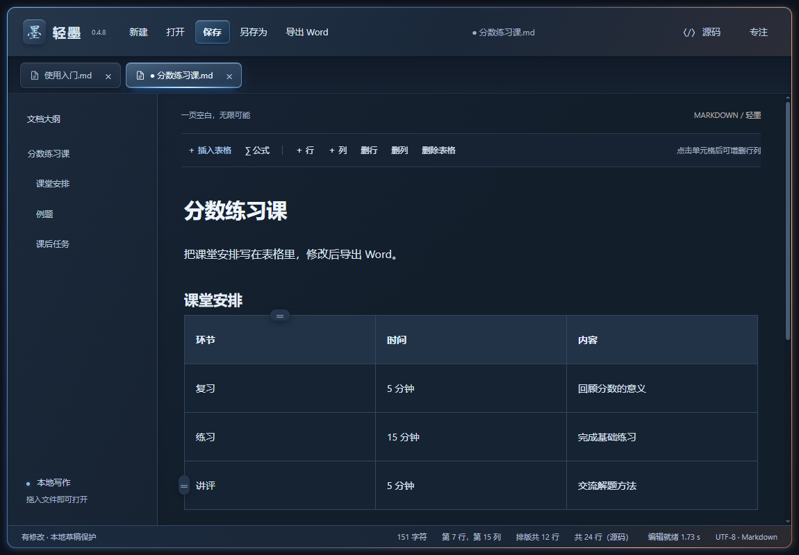

# 轻墨：表格点格修改，改完交 Word

**Markdown 表格难改？用轻墨，点格就能改，改完交 Word。**

[下载 Windows 64 位 EXE](https://github.com/zhangning-accp/qingmo/releases/latest/download/Qingmo-Windows-x64.exe) · [查看项目](https://github.com/zhangning-accp/qingmo)

## 35 秒看一次实际操作

[观看或下载操作视频（MP4，约 0.5 MB）](https://raw.githubusercontent.com/zhangning-accp/qingmo/main/docs/promotion/qingmo-demo.mp4)

视频展示修改单元格、增加一行、用可视化公式编辑器输入分式、导出 DOCX。结尾展示在 WPS 中继续修改单元格后的实际页面。演示使用轻墨 0.4.8 Windows 运行包；保存窗口的等待已剪去，附中文字幕，无配音。

## 跟着做

- [Markdown 表格怎么直接编辑？](markdown-table-edit.md)
- [带公式的 Markdown 怎么转成可编辑 Word？](markdown-to-word-math.md)

两篇教程共用以下示例，方便对照操作：

| 文件 | 用途 |
| --- | --- |
| [修改前的 Markdown](demo-before.md) | 时间为 10 分钟，公式为 0.5 |
| [修改后的 Markdown](demo-after.md) | 时间改为 15 分钟，增加讲评行，公式改为二分之一 |
| [轻墨实际导出的 Word](https://raw.githubusercontent.com/zhangning-accp/qingmo/main/docs/promotion/demo-after.docx) | 包含可编辑表格和 Office 分式公式；保留导出时的 15 分钟 |

视频末尾的 20 分钟是导出后在 WPS 中的编辑演示，不写回上面的 Word 原件。

## 分享材料

[社群短介绍](community-post.txt) · [V2EX 发布正文](v2ex-post.md) · [视频标题与简介](video-copy.md)

运行环境为 Windows 10/11 x64，需要 WebView2。常见数学公式支持 Word 导出；复杂公式会给提示。更多功能与当前边界见[项目说明](../../README.md)。
