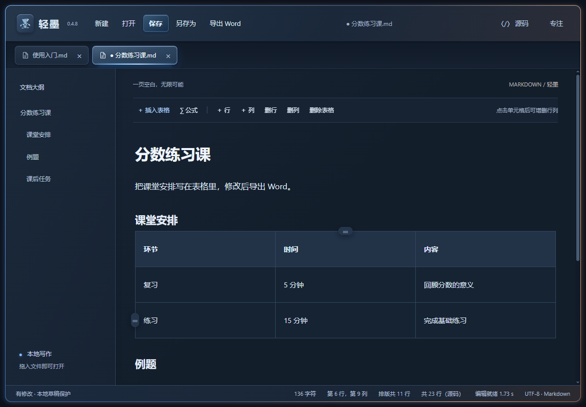
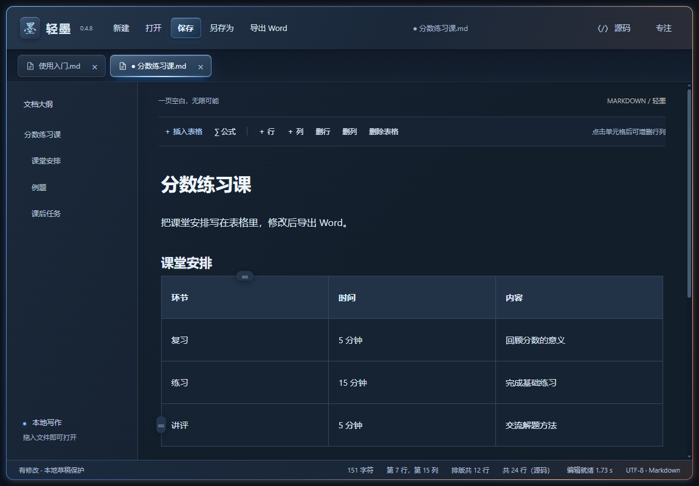
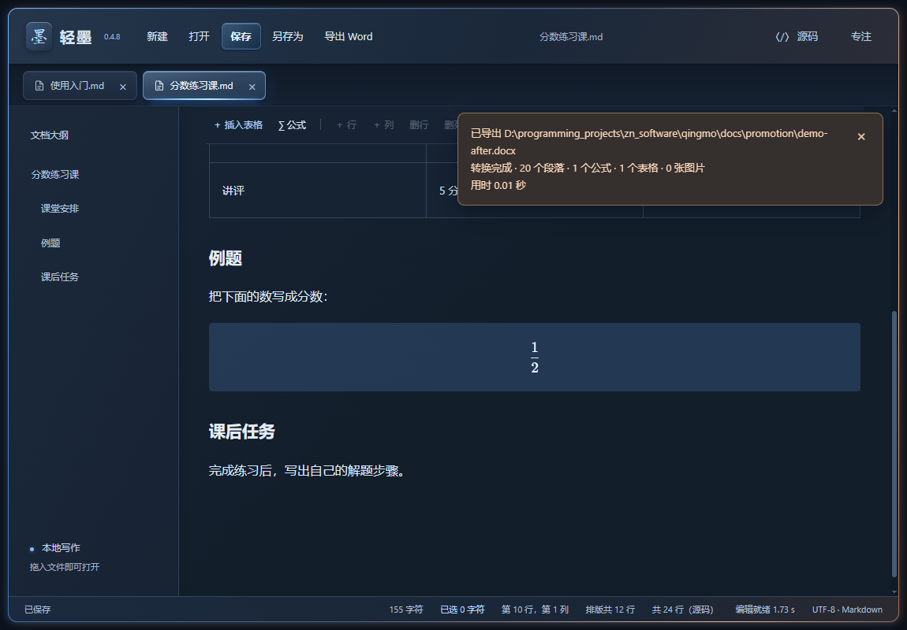

# Markdown 表格怎么直接编辑？在轻墨里改内容、加行，再导出 Word

写好一张 Markdown 表格，再改某个单元格、插入一行，往往要回到一排竖线里找位置。整理教案和项目安排时，我希望直接点进表格修改，交稿时还能得到 Word 文件。这也是我做轻墨的原因。

下面用轻墨 0.4.8 的一份“分数练习课”示例演示。轻墨支持 Windows 10/11 64 位，需要 WebView2。

[下载轻墨 EXE](https://github.com/zhangning-accp/qingmo/releases/latest/download/Qingmo-Windows-x64.exe) · [下载演示 Markdown](https://raw.githubusercontent.com/zhangning-accp/qingmo/main/docs/promotion/demo-before.md)

## 把 10 分钟改成 15 分钟

打开示例文件。若当前显示源码，点右上角「排版」。在表格中点击“10 分钟”，选中这几个字，输入“15 分钟”。光标就在单元格里，按 Tab 可以移到下一格。



如果手头只有一段 Markdown，也可以点「新建」，切到「源码」粘贴内容，再点「排版」。下面这段就能试：

```markdown
| 环节 | 时间 | 内容 |
| --- | --- | --- |
| 复习 | 5 分钟 | 回顾分数的意义 |
| 练习 | 10 分钟 | 完成基础练习 |
```

## 在练习后面加一行讲评

先点“练习”这一行中的任意单元格，再点编辑区上方的「＋ 行」。在新增行里依次填入“讲评”“5 分钟”“交流解题方法”，格子之间用 Tab 切换。



「＋ 列」「删行」「删列」也是先把光标放进表格再操作。按钮灰着时，检查光标是不是已经离开表格。误删可以按 Ctrl+Z 撤销。

我更愿意在排版视图里改这类课堂安排表；需要精确保留特殊 Markdown 扩展语法时，则用源码视图并另存一份。轻墨目前支持 CommonMark / GFM 子集，排版编辑可能规范化原来的 Markdown 写法。

## 改完交 Word

点顶部「导出 Word」，选择保存位置。完成后，右上角会显示导出结果。这份示例导出的是 Word 表格，后续可以继续修改单元格内容。



[查看修改后的 Markdown](demo-after.md) · [下载导出的 Word 示例](https://raw.githubusercontent.com/zhangning-accp/qingmo/main/docs/promotion/demo-after.docx) · [继续看：公式怎么编辑和转 Word](markdown-to-word-math.md)

轻墨的源码、运行包和问题反馈入口都在 [GitHub 仓库](https://github.com/zhangning-accp/qingmo)。
