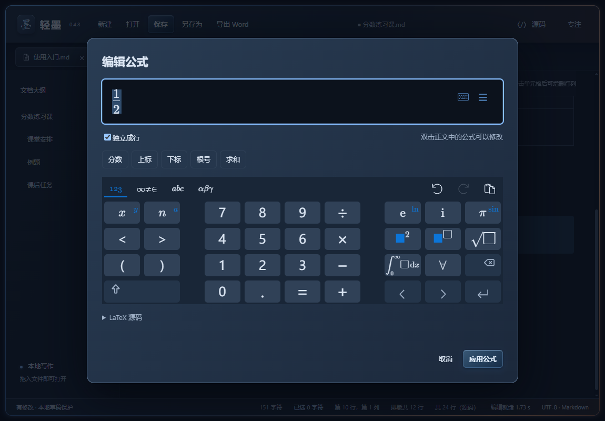
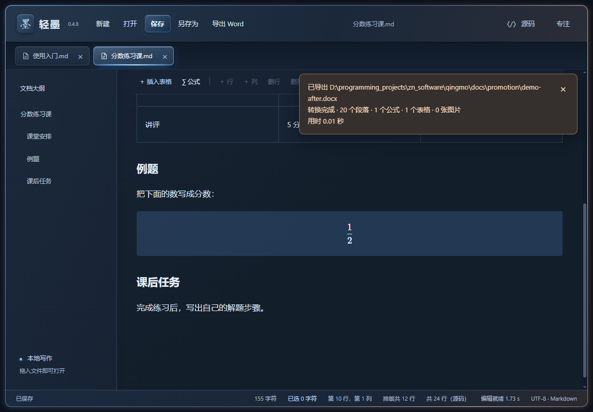

# 带公式的 Markdown 怎么转成可编辑 Word？用轻墨完成 md2word

Markdown 里能看到分式，交给别人时还要能继续改。轻墨的「导出 Word」会把支持的数学公式转成 Office 公式结构，和正文、表格一起放进 `.docx`。

本文使用轻墨 0.4.8，示例和操作视频使用同一份“分数练习课”。可以先下载 [原始 Markdown](https://raw.githubusercontent.com/zhangning-accp/qingmo/main/docs/promotion/demo-before.md) 和 [导出的 Word](https://raw.githubusercontent.com/zhangning-accp/qingmo/main/docs/promotion/demo-after.docx)，对照查看。

## 双击公式，把 0.5 改写成分数

用轻墨打开示例，在排版视图里双击 `0.5`。打开公式编辑器后，选中公式内容，点「分数」。输入分子 `1`，按 Tab 跳到分母，再输入 `2`，最后点「应用公式」。



模板没有填完时，窗口会提示还有几个空白框，填完后才能应用。光标可以直接点进分子、分母或上下标；需要手写 LaTeX 时，展开窗口下方的「LaTeX 源码」。

如果新建公式，用工具栏的「∑ 公式」。在源码里，行内公式写成 `$x^2$`；独立成行可以这样写：

```latex
$$
\frac{1}{2}
$$
```

公式写在 Markdown 代码块内时会作为代码显示。需要排版公式，应把上面的内容放到正文中，去掉代码块外层的三反引号。

## 导出后，先看结果提示

点顶部「导出 Word」，在保存窗口选好位置。右上角会给出导出路径、公式和表格数量。本例包含一个分式和一张课堂安排表。



导出的 `.docx` 可以交给使用 Word 的人。示例中的表格保留为表格，二分之一保留为 Office 数学公式结构。这样后续还可以继续修改，而不必重新照着图片输入。

复杂 LaTeX 的显示能力和 Word 转换能力有差别：轻墨支持常见公式导出，遇到不支持的内容会给出提示。我建议在交付前打开导出的文件检查一次，尤其是嵌套较多、带自定义命令的公式。当前也不支持自定义 Word 模板。

[下载轻墨 Windows EXE](https://github.com/zhangning-accp/qingmo/releases/latest/download/Qingmo-Windows-x64.exe) · [查看源码与反馈问题](https://github.com/zhangning-accp/qingmo) · [表格编辑教程](markdown-table-edit.md)

运行环境为 Windows 10/11 64 位，需要 Microsoft Edge WebView2 Runtime。
