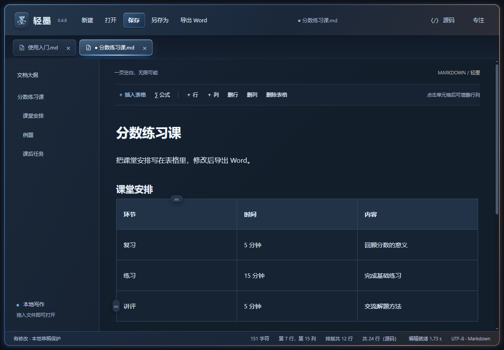
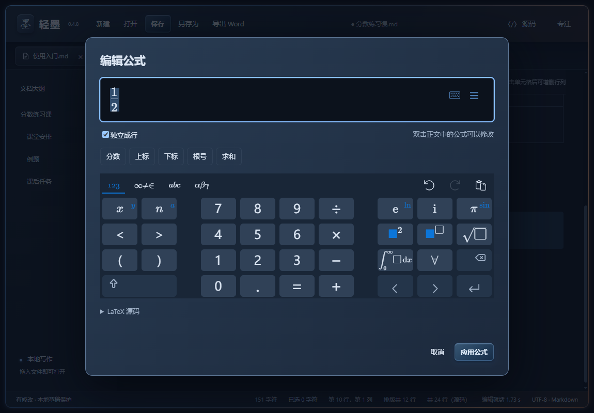

# 做了个 Windows Markdown 编辑器「轻墨」：表格点格修改，公式可视化编辑，改完导出 Word

自己用 Markdown 写东西时，最不顺手的是改表格：找单元格、补一行、调整列，都要在源码里来回找。内容整理好了，又经常要交一份 Word。

于是做了轻墨，一个基于 Rust / Tauri 的 Windows Markdown 编辑器。目前公开了源码和可直接运行的 EXE，版本是 0.4.8。

它主要把这几个操作接起来：

- 排版视图里直接点击表格单元格修改，用按钮增删行列。
- 双击数学公式，打开 MathLive 可视化编辑器，点击分子、分母、上下标修改，也保留 LaTeX 源码入口。
- 点击「导出 Word」，生成 DOCX，支持可编辑表格和常见 Office 数学公式。
- 支持多标签、文件拖入、新建空标签粘贴 Markdown，源码视图有行号，底部有光标行列和选区字符数。

录了一段操作演示：把课堂安排表里的时间改掉，加一行讲评，把 0.5 改成分式，再导出 Word。视频、修改前后的 Markdown 和实际导出的 DOCX 都放在这里：

https://github.com/zhangning-accp/qingmo/tree/main/docs/promotion

表格编辑：

公式编辑：

适合已经用 Markdown 整理教案、试题、方案，又需要交 Word 的人。运行环境是 Windows 10/11 x64，需要 WebView2。

当前仍有边界：排版编辑支持 CommonMark / GFM 子集；复杂公式导出会给提示；暂不支持自定义 Word 模板、PDF 导出和图片资源管理。大文档优先显示源码，首次切到排版仍需要等待。

下载：https://github.com/zhangning-accp/qingmo/releases/latest/download/Qingmo-Windows-x64.exe

源码：https://github.com/zhangning-accp/qingmo

也写了两篇跟着操作的教程：

- [Markdown 表格怎么直接编辑？](https://github.com/zhangning-accp/qingmo/blob/main/docs/promotion/markdown-table-edit.md)
- [带公式的 Markdown 怎么转成可编辑 Word？](https://github.com/zhangning-accp/qingmo/blob/main/docs/promotion/markdown-to-word-math.md)

欢迎拿常用文档试试。想听听大家改表格、改公式、转 Word 时最卡的是哪一步；遇到问题可以在仓库提 issue，附上去掉隐私内容的最小示例。
